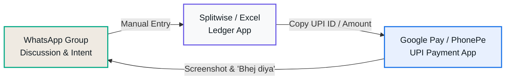
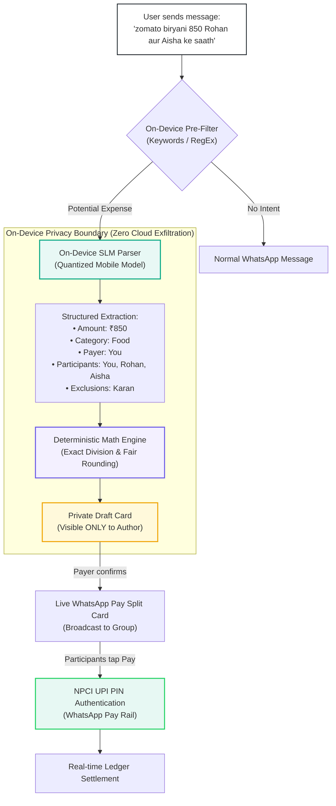

# WhatsApp Split 💸

> **Chat-native expense splitting and instant UPI settlement for groups — with an on-device, privacy-first AI that understands how India talks about money.**

[](https://pavitrapoojary.github.io/whatsapp-pay/)
[](WhatsApp_Split_PRD_v3_0.docx)
[](https://www.npci.org.in/)
[](https://pavitra-poojary.vercel.app/)

---

## 📌 Executive Summary

Every month, millions of groups across India (flatmates, trip companions, office squads, sports clubs) coordinate expenses inside WhatsApp, yet are forced to settle them elsewhere. The current journey is fragmented across **three separate apps**:



This app-switching causes **forgotten debts, social awkwardness in chasing friends, and transaction drop-off**. 

**WhatsApp Split** closes this loop directly within WhatsApp. It introduces an on-device language model that understands colloquial Indian English, Hindi, and Hinglish (`"chai nashta 160 bhara"`, `"cab 420 Rohan ko chhod ke"`), creates a **private draft** for the payer to review, and broadcasts an interactive **WhatsApp Pay UPI settlement card** right inside the conversation stream.

---

## 🚀 Key Value Propositions & Features

| Capability | What It Does | Why It Matters |
| :--- | :--- | :--- |
| **🗣️ Conversational Hinglish Detection** | Accurately extracts amounts, categories, and participant exclusions from informal text (e.g., *"biryani 850 Rohan ke saath"*, *"petrol 600 bharwaya"*, *"bina Aisha ke"*). | Users don't need to fill out rigid forms or leave their active chat thread. |
| **🔒 Private Draft Protection** | Expense detection happens 100% on-device; drafts are strictly private to the author until confirmed with 1 tap. | Zero surprises. No accidental requests or premature charges broadcast to the group. |
| **⚡ 1-Tap UPI Settlement** | Generates an interactive payment card in chat. Debtors tap **"Pay"** and enter their 4-digit UPI PIN via WhatsApp Pay. | Settles debts in seconds without copy-pasting VPA / UPI IDs or uploading payment screenshots. |
| **🗓️ Monthly Accrual & Netting Engine** | Accrues recurring shared bills (rent, groceries, maid) and runs a debt-simplification greedy graph algorithm at month-end. | Compresses $N \times (N-1)$ potential cross-transfers down to at most $N-1$ optimal settlements (≥50% transaction reduction). |
| **🤖 Impartial Social Nudges** | An automated time-travel reminder ladder (Gentle Day 1 Nudge → Day 3 Reminder → Day 7 Direct Nudge). | Eliminates the awkward 1-on-1 personal chase; the system acts as an impartial bookkeeper. |
| **📊 Shared Ledger & Money Insights** | Group members can tap the Insights icon to inspect category totals, who-paid-what matrices, and query spending via Meta AI. | Provides full auditability: *"Every number is computed deterministically, never hallucinated by generative AI."* |

---

## 💡 System Architecture: "AI Reads, Code Calculates"

A foundational product principle of WhatsApp Split is **strict separation between cognitive parsing and financial computation**:



### The AI-Worthiness Framework
The PRD applies an explicit test before granting any feature to generative or statistical models:
1. **Language Processing (Granted to AI)**: High variance, code-switched Hinglish/regional dialects cannot be reliably captured by static regex. Quantized on-device models parse intent safely.
2. **Financial Math & Rounding (Rejected for AI)**: Entrusting share calculation or debt netting to an LLM risks rounding errors and hallucinations. Handled by a deterministic mathematical engine.
3. **Sensitive Item Redaction**: Health, medical, and personal items (e.g., pharmacy bills in direct chats) are automatically masked to safeguard privacy.

---

## 🧮 Mathematical Netting Engine

In recurring groups (such as flatmates in *Flat 302*), members incur dozens of cross-debts throughout the month. Rather than requiring everyone to pay individual shares back and forth, WhatsApp Split computes the net balance vector:

$$\text{Net}_i = \sum \text{Paid By } i - \sum \text{Share Owed By } i$$

A greedy balance-matching algorithm partitions users into creditors ($\text{Net} > 0$) and debtors ($\text{Net} < 0$), sorted by magnitude, and matches them:

```javascript
// Greedy Debt Simplification
while (creditorIdx < creditors.length && debtorIdx < debtors.length) {
  const transfer = Math.min(creditors[creditorIdx].amt, debtors[debtorIdx].amt);
  transactions.push({
    from: debtors[debtorIdx].name,
    to: creditors[creditorIdx].name,
    amount: transfer
  });
  creditors[creditorIdx].amt -= transfer;
  debtors[debtorIdx].amt -= transfer;
  if (creditors[creditorIdx].amt === 0) creditorIdx++;
  if (debtors[debtorIdx].amt === 0) debtorIdx++;
}
```

> **Guaranteed Upper Bound**: Compresses arbitrary $N$-person ledgers into at most $N - 1$ single-hop UPI transactions.

---

## 📱 Interactive Prototype Features

The repository includes a production-grade, zero-dependency interactive prototype contained in [`index.html`](file:///c:/Users/pavit/Documents/MBA/2025/PROJECTS/whatsapp-pay/index.html).

### 1. Multi-Chat Contexts & Personas
Switch seamlessly across 5 realistic conversation scenarios:
- **Flat 302 🏠**: Monthly household accrual (Rent ₹24,000, Groceries ₹3,200, Wifi, Utilities).
- **Goa Trip 🏖️**: Vacation spending with uneven shares and exclusions (Scooty rentals, shack food, petrol).
- **Office Squad 💼**: Fast-paced workplace lunch and coffee runs (Starbucks, Swiggy, auto rides).
- **Cricket Sunday 🏏**: Club captain managing PlayArena turf booking and equipment with cash tracking.
- **Mom ❤️**: 1-on-1 direct chat tracking personal expenses with automatic healthcare masking.

### 2. Multi-Persona Viewer Switcher
Inspect the group from any member's perspective (**Pavitra, Rohan, Aisha, Karan**) to experience how payment buttons, draft cards, and cash confirmation prompts dynamically adapt to the active user.

### 3. Realistic 4-Digit UPI PIN Bottom Sheet
Simulates the authentic NPCI UPI PIN authentication sheet with masked password digits and instant settlement response.

### 4. Time Travel & Automation Engine
- `⏩ Skip 1 Day`: Fast-forward time to simulate reminder cadence and social nudges.
- `📊 Month-end Digest`: Auto-generates a clean financial summary in the chat thread.
- `🗓️ Run Settle-Up`: Executes the netting engine on accrued monthly expenses.
- `↺ Reset`: Restores seed ledger states cleanly.

### 5. Interactive WalkMe Guided Tour
A built-in 6-step guided walkthrough featuring animated spotlights, pulsing beacons, and smart contextual cards highlighting the core product flows.

---

## 🎯 Metrics & North Star Framework

```
                       [ North Star Metric ]
           Share of Instant-Mode Splits Fully Settled ≤ 72h
                         (GA Target: ≥ 70%)
                                 │
     ┌───────────────────────────┼───────────────────────────┐
     ▼                           ▼                           ▼
[ Input: UX Velocity ]   [ Input: AI Accuracy ]     [ Safety & Trust ]
• Median Time-to-Settle  • Draft Acceptance (≥75%)  • Unconfirmed Requests: 0
  (Target: < 12 Hours)   • False-Draft Rate (≤8%)   • Sensitive Exposures: 0
• Netting Compression    • Language Coverage Gap    • Dispute Rate: ≤ 0.01%
  (≥50% fewer transfers)   (≤ 5 pts from English)   • Mute / Exit Rate: ≤ 0.1%
```

---

## 💻 Getting Started Locally

The prototype is built with **vanilla web technologies (HTML5, Modern CSS, ES6+ JavaScript)**. It requires zero compilation, build steps, or external dependencies.

### Option 1: Direct Browser Launch
Simply double-click [`index.html`](file:///c:/Users/pavit/Documents/MBA/2025/PROJECTS/whatsapp-pay/index.html) or open it in any modern web browser:
```bash
# Windows
start index.html

# macOS
open index.html

# Linux
xdg-open index.html
```

### Option 2: Local Static Server
To serve via Node.js:
```bash
npx serve .
# or
python -m http.server 8000
```
Then visit `http://localhost:8000` in your browser.

---

## 📂 Repository Contents

```
├── index.html                       # Complete, self-contained interactive prototype
├── WhatsApp_Split_PRD_v3_0.docx     # Comprehensive Product Requirements Document (PRD v3.0)
├── drafts/
│   ├── WhatsApp_Split_PRD_v1.0.docx # Initial concept and keyword detection specs
│   └── WhatsApp_Split_PRD_v2.0_GA.docx # V2 On-device SLM & Netting additions
└── README.md                        # Documentation & Architecture Overview
```

---

## 👨‍💻 Author & Product Design

Designed and architected with curiosity by **Pavitra Poojary**:
- 🌐 **Portfolio**: [pavitra-poojary.vercel.app](https://pavitra-poojary.vercel.app/)
- 🐙 **GitHub**: [@pavitrapoojary](https://github.com/pavitrapoojary)
- 💼 **Project Repo**: [github.com/pavitrapoojary/whatsapp-pay](https://github.com/pavitrapoojary/whatsapp-pay)

---

## 📄 License

This prototype and product specification are licensed under the [MIT License](LICENSE) — created for product management demonstration, portfolio review, and design exploration.
